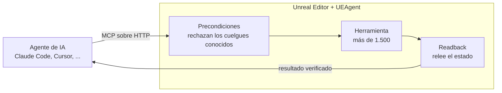

<p align="center">
  
</p>

<h1 align="center">UEAgent</h1>

<p align="center">
  <b>El servidor MCP para Unreal Engine 5, integrado en el editor.</b><br>
  Más de 1.500 herramientas para que Claude Code, Cursor o cualquier cliente MCP construya en Unreal,<br>
  con cada cambio comprobado antes de ejecutarse y releído después.
</p>

<p align="center">
  
  
  
  <a href="LICENSE"></a>
  <a href="https://github.com/CarlxsMG/UEAgent/actions/workflows/ci.yml"></a>
  <a href="https://carlxsmg.github.io/UEAgent/"></a>
  <a href="https://glama.ai/mcp/servers/CarlxsMG/UEAgent"></a>
</p>

<p align="center"><a href="README.md">English</a> · <b>Español</b></p>

---

UEAgent es un plugin de editor para Unreal Engine 5.7 y 5.8 que permite a agentes de IA manejar el editor
mediante el [Model Context Protocol](https://modelcontextprotocol.io). El plugin **es** el servidor:
sirve Streamable HTTP desde dentro del editor, sin ningún proceso de Python o Node por medio.

> La documentación detallada está en inglés. Esta traducción puede ir por detrás del
> [README en inglés](README.md).

## Por qué UEAgent

- **Todo el motor, no una demo.** Blueprints y sus grafos, materiales, animación (AnimBP, montajes,
  IK, Pose Search), Niagara, paisajes y foliage, World Partition, PCG, Sequencer, UMG/CommonUI/MVVM,
  GAS, IA (Behavior Trees, StateTree, EQS, Smart Objects), audio y MetaSounds, USD e Interchange,
  control e inspección de PIE: consulta la [referencia de herramientas](docs/tools/README.md).
- **Verificado, no supuesto.** Que una llamada al editor responda `success: true` no demuestra nada,
  así que cada llamada pasa por un contrato:
  - las *precondiciones* rechazan las llamadas que se sabe que cuelgan o tumban el editor, y dicen
    qué hacer en su lugar;
  - el *readback* vuelve a leer el estado después de la llamada, y da por fallida una escritura que no
    se aplicó, un cero que no prueba nada o un cambio que acabó en el mundo de PIE equivocado.
- **Seguro con tu contenido.** Cada llamada es un paso de deshacer con el nombre de la herramienta,
  así que Ctrl+Z la revierte. Las librerías de terceros que declares como **Read Only Content Roots**
  no se pueden guardar, renombrar, mover ni borrar desde ninguna herramienta, y las llamadas que no son
  fiables con Play-in-Editor en marcha se rechazan mientras dure.
- **Hecho para sesiones reales.** Varios agentes pueden compartir un editor: el trabajo del protocolo
  va en hilos de red, y cada llamada se ejecuta en el hilo de juego a través de una sola cola. El panel
  **Activity** (barra de estado > MCP > Activity) muestra cada llamada con su duración y su resultado.



En qué se diferencia un servidor dentro del editor de uno fuera de él, y qué preguntarle a cualquier
servidor MCP para Unreal: [Choosing an MCP server](docs/choosing.md) (en inglés).

## Primeros pasos

**Que lo haga tu agente.** Abre Claude Code, Cursor, Codex u otro agente en la carpeta de tu proyecto y
pega:

```
Instala el plugin UEAgent en este proyecto de Unreal Engine y conéctate a él siguiendo https://raw.githubusercontent.com/CarlxsMG/UEAgent/main/llms-install.md
```

Hace los pasos de abajo, comprueba el SHA-256 de la descarga y pregunta antes de cambiar nada; al final
tú recargas sus servidores MCP. Ver [llms-install.md](llms-install.md). O a mano:

1. **Instala.** Descarga el último `UEAgent-*-UE5.8-Win64.zip` (o `-UE5.7-`, según tu motor) de
   [Releases](https://github.com/CarlxsMG/UEAgent/releases) y descomprímelo en
   `<TuProyecto>/Plugins/`, o [compílalo desde el código](#compilar-desde-el-código).
2. **Abre el proyecto.** La barra de estado muestra **MCP · 55561** con un punto verde cuando el
   servidor está listo (si no, consulta [Troubleshooting](docs/troubleshooting.md)).
3. **Conecta un agente.** Desde el menú de esa barra de estado, **Connect Claude Code to this project**
   escribe la entrada `unreal` en el `.mcp.json` de tu proyecto, y **Connect another client** hace lo
   mismo para Cursor, VS Code, Antigravity CLI y OpenCode (y copia el comando de Codex). O, solo
   para ti:

   ```
   claude mcp add --transport http unreal http://127.0.0.1:55561/mcp
   ```

   Cualquier cliente MCP que hable Streamable HTTP puede conectarse a la misma URL: consulta
   [Clientes](#clientes).
4. **Pide.** Por ejemplo: *«Crea un actor Blueprint BP_Door con una malla de puerta y un trigger de
   caja, y abre la puerta con un timeline cuando el jugador entre en el trigger.»*

## Qué puedes pedir

| Petición | Herramientas que usa |
|---|---|
| «Crea BP_Door: una malla y un trigger de caja que abran la puerta con un timeline al solaparse.» | `create_blueprint`, `add_component_to_blueprint`, `build_blueprint_graph`, `compile_blueprint` |
| «Busca todos los Blueprints de /Game que no compilan y dime por qué.» | `find_erroring_blueprints`, `get_graph_nodes`, `lint_blueprint_graph` |
| «Haz una variante roja de M_Base y pónsela a las cajas de este nivel.» | `create_material_instance`, `get_actors_by_class`, `set_actor_material` |
| «Juega el nivel, lee la vida del jugador, haz una captura y para.» | `start_play_in_editor`, `get_properties`, `capture_pie_screenshot`, `stop_play_in_editor` |
| «Monta un plano: un corte de cámara, un fundido de entrada y el sonido de intro en el fotograma 0.» | `create_level_sequence`, `add_camera_cut_track`, `add_fade_track_to_sequence`, `add_audio_section` |
| «¿Qué assets míos siguen referenciando el pack del vendedor, y qué clases heredan de él?» | `audit_asset_references`, `audit_class_purity`, `run_map_check` |

Más en [Examples](docs/examples.md).

## Clientes

| Cliente | Notas |
|---|---|
| Claude Code | Conexión con un clic desde la barra de estado del editor. Carga las herramientas bajo demanda, así que con `?tools=all` al final de la URL recibe todas. |
| Cursor, VS Code, Windsurf, Claude Desktop, Gemini CLI, Codex | Cualquier cliente con Streamable HTTP: consulta [la configuración de cada uno](docs/clients.md). |

Por defecto el servidor lista sus herramientas básicas y cuatro herramientas que buscan, describen y
ejecutan el resto, o añaden un dominio entero a la lista. Con `?tools=all` al final de la URL lista
todas, y con `?tools=compact` solo tres: consulta las [listas de herramientas](docs/clients.md#tool-lists).

## Directorios

UEAgent aparece en:

- el [registro oficial de MCP](https://registry.modelcontextprotocol.io), como `io.github.CarlxsMG/UEAgent`,
  del que leen otros directorios y clientes;
- [Glama](https://glama.ai/mcp/servers/CarlxsMG/UEAgent), el directorio de servidores MCP;
- [awesome-mcp-servers](https://github.com/punkpeye/awesome-mcp-servers#gaming), en Gaming;
- [awesome-unreal](https://github.com/insthync/awesome-unreal#editor), en Editor.

<a href="https://glama.ai/mcp/servers/CarlxsMG/UEAgent"></a>

## Skills

UEAgent trae skills en el formato abierto Agent Skills, para Claude Code, Codex, Cursor, VS Code,
Antigravity CLI, Gemini CLI y OpenCode. Se instalan en el proyecto desde la barra de estado del editor:
**MCP · 55561 > Skills**. Vienen con el plugin, así que siempre casan con sus herramientas.

| Skill | |
|---|---|
| `ueagent-skill-builder` | Convierte un flujo que quieres repetir en una skill nueva: busca las herramientas, ensaya la tarea en el editor, comprueba el resultado y escribe el `SKILL.md` |
| `ueagent-blueprint-actor` | Un actor Blueprint a partir de una descripción: componentes, grafo, compilación limpia y una instancia en el nivel |
| `ueagent-project-audit` | Qué está roto y qué sobra, de lo más grave a lo menos |
| `ueagent-level-lighting` | Iluminación exterior (sol, cielo, sky light, niebla) y una captura |
| `ueagent-report-issue` | Reporta un fallo o pide una herramienta como issue de GitHub, con las versiones, la llamada y el log |
| `ueagent-contribute-fix` | Convierte un cambio en el código del plugin en un pull request, con las reglas del repositorio |

El cliente las carga solo cuando una petición encaja. Más en [Skills](docs/skills.md).

## Documentación

También en la web, con buscador y un explorador de herramientas: [carlxsmg.github.io/UEAgent](https://carlxsmg.github.io/UEAgent/).

| | |
|---|---|
| [Clients](docs/clients.md) | Conectar Claude Code, Cursor, VS Code, Windsurf, Claude Desktop, Gemini CLI y Codex |
| [Examples](docs/examples.md) | Peticiones que funcionan bien, y las herramientas que usan |
| [Skills](docs/skills.md) | El plugin de Claude Code: un constructor de skills y tres skills hechas con él |
| [Tool reference](docs/tools/README.md) | Todas las herramientas, por dominio |
| [Answers and refusals](docs/responses.md) | Qué devuelve una llamada, y cómo leer un rechazo o un veredicto de readback |
| [FAQ](docs/faq.md) | Versiones, seguridad, coste |
| [Troubleshooting](docs/troubleshooting.md) | Cuando un cliente no conecta o una llamada se rechaza |
| [Architecture](docs/architecture.md) | Cómo recorre una llamada el editor, y el contrato que la rodea |
| [Glossary](docs/glossary.md) | Las palabras que usan la documentación y las respuestas de las herramientas |

## Requisitos

- Unreal Engine 5.7 o 5.8 en Windows (Win64), la única plataforma que declara el plugin. Cada release
  trae un zip para cada motor; unas pocas herramientas necesitan la 5.8 (ver la [FAQ](docs/faq.md)).
- Para compilar desde el código: Visual Studio 2022 con el toolchain de C++.
- El plugin activa los plugins del motor que usan sus herramientas (ver `UEAgent.uplugin`), entre
  ellos PythonScriptPlugin, EditorScriptingUtilities, Niagara, PCG, StateTree, ControlRig, IKRig,
  PoseSearch, Interchange y USD. La excepción es Game Features: el plugin no lo activa, y sus cinco
  herramientas funcionan en cuanto tu proyecto lo activa.

### Compilar desde el código

Copia o clona este repositorio en `<TuProyecto>/Plugins/UEAgent`, abre el proyecto y deja que Unreal
lo compile, o compila el target del editor desde tu IDE. Al arrancar el editor, el log muestra
`MCP HTTP server started on http://127.0.0.1:55561/mcp (... tools ...)`.

## Actualizar

**MCP · 55561 > Check for updates** pregunta a GitHub por la última versión. Si es más nueva,
**Download and install** descarga el zip de tu versión del motor, lo comprueba con el
`SHA256SUMS.txt` de la versión y lo instala al cerrar el editor, o en el momento con **Restart now**,
que cierra el editor, la instala y lo vuelve a abrir. La versión anterior se guarda en
`Saved/UEAgentUpdate/Backup`, y si la nueva no se puede colocar, la anterior vuelve a su sitio.

Una copia clonada con git se actualiza con `git pull`, y una instalada desde Fab, desde el Epic Games
Launcher. Después de actualizar, vuelve a conectar tu cliente para que liste de nuevo las herramientas.

## Configuración

**Editor Preferences > Plugins > UEAgent** (por usuario):

| Ajuste | Por defecto | |
|---|---|---|
| Enable HTTP server | activado | el servidor MCP |
| HTTP port | 55561 | `-McpHttpPort=N` en la línea de comandos lo sustituye |
| Auth token | vacío | si se rellena, cada petición necesita `Authorization: Bearer <token>` |
| Show connect hint | activado | al arrancar, ofrece conectar Claude Code si el proyecto no lo está |
| Check for updates at startup | desactivado | preguntar a GitHub como mucho una vez al día si hay una versión nueva (ver [Actualizar](#actualizar)) |

**Project Settings > Plugins > UEAgent** (compartido, se guarda en `Config/DefaultEditor.ini`):

| Ajuste | Por defecto | |
|---|---|---|
| Read Only Content Roots | vacío | raíces de librerías de terceros (p. ej. `/Game/SomeMarketplacePack`): las herramientas se niegan a guardar, renombrar, mover o borrar nada ahí, y las auditorías de linaje tratan sus clases como clases de librería |
| Project Content Root | `/Game` | ámbito por defecto de `audit_class_purity` |
| Fork Origin Tag | `mcp.forkOrigin` | etiqueta de metadatos que escribe `fork_class_chain` y comprueba `audit_class_purity` |

## Comandos de consola

| Comando | |
|---|---|
| `mcp.http.status` / `mcp.http.restart` | estado del servidor; reiniciarlo (también recarga el catálogo de herramientas) |
| `mcp.claude.status [ruta]` / `mcp.claude.connect [ruta]` | inspeccionar / escribir la entrada de `.mcp.json` |
| `mcp.clients.status` / `mcp.clients.connect cursor\|vscode\|antigravity\|opencode [ruta]` | lo mismo para los ficheros de los otros clientes |
| `mcp.skills.status` / `mcp.skills.install` / `mcp.skills.remove` `[claude\|agents\|all]` | las skills de UEAgent en el proyecto (ver [Skills](docs/skills.md)) |
| `mcp.contract.selftest <vectors.json> [quit]` | ejecutar los vectores del contrato (ver `Resources/ContractTests`) |
| `mcp.ReadOnlyRootEnforcement 0\|1` | 0 = solo avisar de los guardados bajo una raíz de solo lectura, en vez de rechazarlos |
| `mcp.UndoStepPerCall 0\|1` | 0 = dejar el historial de deshacer a cada herramienta, en vez de un paso por llamada |
| `mcp.activity [N]` | escribir en el log las últimas N llamadas (20 por defecto), como las muestra el panel Activity |
| `mcp.update.check` / `mcp.update.status` / `mcp.update.download` / `mcp.update.cancel` | buscar una versión nueva; el estado de la actualización; descargarla (se instala al cerrar el editor); descartar una ya descargada |

## Seguridad

- El servidor solo escucha en 127.0.0.1. Además rechaza una petición cuyo `Host` no sea el loopback
  (DNS rebinding) o cuyo `Origin` sea una página web.
- Sin **Auth token**, cualquier proceso de la máquina puede llamarlo. Pon uno en una máquina
  compartida; la entrada de `.mcp.json` lo lee de `${UEAGENT_TOKEN}`.
- Las herramientas actúan con los permisos del editor: ejecutan Python, leen y escriben ficheros,
  guardan, renombran y borran assets, editan ficheros `.ini` y lanzan procesos (un empaquetado, un
  servidor dedicado). Conectar un agente es darle el editor. **Read Only Content Roots** impide que
  las herramientas guarden, renombren, muevan o borren nada bajo las raíces que indiques.

Para informar de una vulnerabilidad, consulta [SECURITY.md](SECURITY.md).

## Privacidad

UEAgent no envía nada sobre ti ni sobre tu proyecto: sin telemetría, sin analíticas. Su única
conexión propia es a GitHub, para buscar una versión nueva: cuando pulsas **Check for updates**, o una
vez al día al arrancar si activas **Check for updates at startup** (viene desactivado). Esa petición
dice qué versión de UEAgent pregunta, y nada más. El servidor solo escucha en 127.0.0.1, y la
respuesta de cada herramienta va al cliente MCP que hayas conectado, en la misma máquina. Lo que ese
cliente envíe después a su proveedor de modelos depende del cliente.

## Accesibilidad

Qué ofrecen en accesibilidad la interfaz del editor y la documentación, qué les falta y cómo informar
de una barrera: consulta [ACCESSIBILITY.md](ACCESSIBILITY.md) (en inglés).

## Contribuir

Las preguntas y las ideas van a [Discussions](https://github.com/CarlxsMG/UEAgent/discussions). Los
informes de errores y los pull requests son bienvenidos: [CONTRIBUTING.md](CONTRIBUTING.md) explica
cómo está organizado el código, cómo se añade una herramienta y qué se comprueba antes de fusionar un
cambio.

## Licencia

UEAgent se publica con la [licencia MIT](LICENSE).

## Marcas

Unreal y Unreal Engine son marcas comerciales o marcas registradas de Epic Games, Inc. en Estados
Unidos y otros países. UEAgent es un proyecto independiente, sin relación con Epic Games ni respaldado
por ella.
