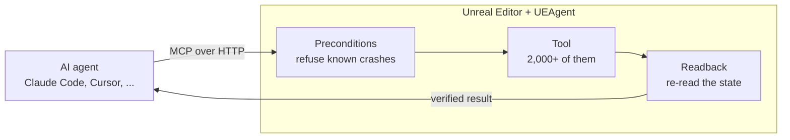

<h1 align="center">UEAgent</h1>

<p align="center">
  <b>The MCP server for Unreal Engine 5, built into the editor.</b><br>
  More than 2,000 tools that let Claude Code, Cursor or any MCP client build in Unreal,<br>
  with every change checked before it runs and read back after.
</p>

<p align="center">
  
  
  
  <a href="LICENSE"></a>
  <a href="https://github.com/CarlxsMG/UEAgent/actions/workflows/ci.yml"></a>
</p>

---

UEAgent is an Unreal Engine 5.8 editor plugin that lets AI agents operate the editor through the
[Model Context Protocol](https://modelcontextprotocol.io). The plugin **is** the server: it serves
Streamable HTTP from inside the editor, with no Python or Node process in between.

## Why UEAgent

- **The whole engine, not a demo.** Blueprints and their graphs, materials, animation (AnimBP,
  montages, IK, Pose Search), Niagara, landscapes and foliage, World Partition, PCG, Sequencer,
  UMG/CommonUI/MVVM, GAS, AI (Behavior Trees, StateTree, EQS, Smart Objects), audio and MetaSounds,
  USD and Interchange, PIE control and inspection: see the [tool reference](docs/tools/README.md).
- **Verified, not assumed.** An editor call that answers `success: true` proves nothing, so every
  call goes through a contract:
  - *preconditions* refuse the calls known to crash or freeze the editor, and say what to do instead;
  - *readback* re-reads the state after the call, and reports as failed a write that did not stick,
    a zero that proves nothing or a change that landed in the wrong PIE world.
- **Safe with your content.** Vendored libraries listed as **Read Only Content Roots** cannot be
  saved, renamed, moved or deleted by any tool, and calls that are unreliable while Play-in-Editor
  runs are refused while it runs.
- **Built for real sessions.** Several agents can share one editor: protocol work runs on network
  threads, and every tool call runs on the game thread through one queue.



## Quick start

1. **Install.** Download the latest `UEAgent-*-UE5.8-Win64.zip` from
   [Releases](https://github.com/CarlxsMG/UEAgent/releases) and unzip it into
   `<YourProject>/Plugins/`, or [build it from source](#build-from-source).
2. **Open the project.** The status bar shows **MCP · 55561** with a green dot once the server is up
   (if it does not, see [Troubleshooting](docs/troubleshooting.md)).
3. **Connect an agent.** From that status-bar menu, **Connect Claude Code to this project** writes the
   `unreal` entry of your project's `.mcp.json`. Or, for yourself only:

   ```
   claude mcp add --transport http unreal http://127.0.0.1:55561/mcp
   ```

   Any MCP client that speaks Streamable HTTP can connect to the same URL: see [Clients](#clients).
4. **Ask.** For example: *"Create a Blueprint actor BP_Door with a door mesh and a box trigger, and
   open the door with a timeline when the player overlaps the trigger."*

## What you can ask

| Ask | Tools it uses |
|---|---|
| "Create BP_Door: a mesh and a box trigger that open the door with a timeline on overlap." | `create_blueprint`, `add_component_to_blueprint`, `build_blueprint_graph`, `compile_blueprint` |
| "Find every Blueprint under /Game that does not compile and tell me why." | `find_erroring_blueprints`, `get_graph_nodes`, `lint_blueprint_graph` |
| "Make a red variant of M_Base and put it on the crates in this level." | `create_material_instance`, `get_actors_by_class`, `set_actor_material` |
| "Play the level, read the player's health, take a screenshot, stop." | `start_play_in_editor`, `get_properties`, `capture_pie_screenshot`, `stop_play_in_editor` |
| "Cut a shot: camera cut, a fade in, and the intro sound at frame 0." | `create_level_sequence`, `add_camera_cut_track`, `add_fade_track_to_sequence`, `add_audio_section` |
| "Which of my assets still reference the vendor pack, and which classes inherit from it?" | `audit_asset_references`, `audit_class_purity`, `run_map_check` |

## Clients

| Client | Notes |
|---|---|
| Claude Code | One-click connection from the editor's status bar. Loads tools on demand, so the full catalog is fine. |
| Cursor, VS Code, Windsurf, Claude Desktop, Gemini CLI, Codex | Any client with Streamable HTTP: see [the setup for each one](docs/clients.md). A client that loads every tool up front needs the [compact tool list](#compact-tool-list). |

### Compact tool list

For a client that cannot take the whole catalog, the server lists three meta-tools instead:

| Tool | |
|---|---|
| `find_tools` | searches the tools by words and/or domain; with no arguments, lists the domains |
| `describe_tool` | one tool's description and input schema |
| `call_tool` | runs a tool by name, with the same checks and readback as a direct call |

Ask for it per client with the URL `http://127.0.0.1:55561/mcp?tools=compact`, or for every client
by starting the editor with the environment variable `UEAGENT_TOOLS=compact` (then
`?tools=full` gives one client the whole list back).

## Requirements

- Unreal Engine 5.8 on Windows (Win64), the only platform the plugin declares.
- To build from source: Visual Studio 2022 with the C++ toolchain.
- The plugin enables the engine plugins its tools use (see `UEAgent.uplugin`): among them
  PythonScriptPlugin, EditorScriptingUtilities, Niagara, PCG, StateTree, ControlRig, IKRig,
  PoseSearch, Interchange and USD. Game Features is the exception: the plugin does not turn it on,
  and its five tools work once your project enables it.

### Build from source

Copy or clone this repository to `<YourProject>/Plugins/UEAgent`, then open the project and let
Unreal build it, or build the editor target from your IDE. When the editor starts, the log shows
`MCP HTTP server started on http://127.0.0.1:55561/mcp (... tools ...)`.

## Settings

**Editor Preferences > Plugins > UEAgent** (per user):

| Setting | Default | |
|---|---|---|
| Enable HTTP server | on | the MCP server |
| HTTP port | 55561 | `-McpHttpPort=N` on the command line overrides it |
| Auth token | empty | when set, every request needs `Authorization: Bearer <token>` |
| Show connect hint | on | at startup, offer to connect Claude Code if the project is not |

**Project Settings > Plugins > UEAgent** (shared, saved to `Config/DefaultEditor.ini`):

| Setting | Default | |
|---|---|---|
| Read Only Content Roots | empty | vendored-library roots (e.g. `/Game/SomeMarketplacePack`): tools refuse to save, rename, move or delete anything there, and lineage audits treat their classes as library classes |
| Project Content Root | `/Game` | default scope of `audit_class_purity` |
| Fork Origin Tag | `mcp.forkOrigin` | metadata tag `fork_class_chain` writes and `audit_class_purity` checks |

## Console commands

| Command | |
|---|---|
| `mcp.http.status` / `mcp.http.restart` | server status; restart (also reloads the tool catalog) |
| `mcp.claude.status [path]` / `mcp.claude.connect [path]` | inspect / write the `.mcp.json` entry |
| `mcp.contract.selftest <vectors.json> [quit]` | run the contract vectors (see `Resources/ContractTests`) |
| `mcp.ReadOnlyRootEnforcement 0\|1` | 0 = only report saves under a read-only root instead of refusing them |

## Security

- The server listens on 127.0.0.1 only. It also refuses a request whose `Host` is not the loopback
  (DNS rebinding) or whose `Origin` is a web page.
- Without an **Auth token**, any process on the machine can call it. Set one on a shared machine;
  the `.mcp.json` entry reads it from `${UEAGENT_TOKEN}`.
- The tools act with the editor's rights: they run Python, read and write files, save, rename and
  delete assets, edit `.ini` files and launch processes (a package build, a dedicated server).
  Connecting an agent gives it the editor. **Read Only Content Roots** keeps the tools from saving,
  renaming, moving or deleting anything under the roots you list.

To report a vulnerability, see [SECURITY.md](SECURITY.md).

## Contributing

Questions and ideas go to [Discussions](https://github.com/CarlxsMG/UEAgent/discussions). Bug reports
and pull requests are welcome: [CONTRIBUTING.md](CONTRIBUTING.md) explains how the code is organized,
how a tool is added and what is checked before a change is merged.

## License

UEAgent is released under the [MIT License](LICENSE).

## Trademarks

Unreal and Unreal Engine are trademarks or registered trademarks of Epic Games, Inc. in the United
States and elsewhere. UEAgent is an independent project, not affiliated with or endorsed by Epic Games.
