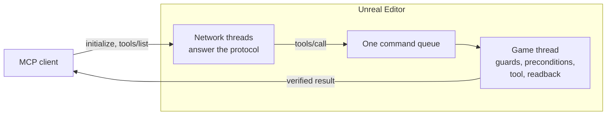

# Architecture

How a call travels from an MCP client to the editor and back, and the contract around it. For the
code layout and how to add a tool, see [CONTRIBUTING.md](https://github.com/CarlxsMG/UEAgent/blob/main/CONTRIBUTING.md).

## The server

`Mcp/McpHttpServer` serves Streamable HTTP from the editor itself, on `127.0.0.1` (port 55561 by
default). An acceptor thread hands each connection to a thread of its own, up to 64:

- `initialize`, `ping` and `tools/list` are answered on that thread, so the editor answers them even
  while it is busy. The `tools/list` answer is serialized once, when the catalog loads.
- `tools/call` crosses to the game thread through the single queue of `UUEAgentBridge`
  (`EnqueueToolCall`): every call, from every client, runs there one at a time, in arrival order.
- While a call runs, its connection thread watches it. If the client asked for progress, the reply
  switches to SSE after 10 seconds and sends a progress notification at least every 15; if the
  client hangs up, the call still finishes and its result is dropped.

`initialize` gives every agent short instructions: how to read a readback verdict and a refusal,
and when to reach for `batch` or `execute_python`.

Every request is checked before anything else: its `Host` must be the loopback and its `Origin`, if
any, local (against DNS rebinding), and with an auth token set, its `Authorization: Bearer` must
match. Headers are capped at 64 KB and a body at 256 MB.

## A call, step by step

On the game thread, `UUEAgentBridge::DispatchSingleCommand` runs every call, and every sub-command of
`batch`, through the same steps:

1. **PIE guards.** While Play-in-Editor runs, calls that compile a Blueprint or write to disk are
   refused unless they carry `force: true`: a compile can keep the play world alive, which the engine
   treats as fatal, and the engine refuses to save during PIE. Starting or stopping a PIE that someone
   else started (by hand, for instance) needs `force: true` too.
2. **Unattended mode.** Modal dialogs are suppressed and answered, so no call can block the game
   thread waiting for a click.
3. **Parameter aliases and rotations.** A parameter spelled the way a sibling tool spells it is
   renamed, and the response says so in `aliased_params`. A `{roll, pitch, yaw}` object becomes the
   wire array `[pitch, yaw, roll]`.
4. **Preconditions** (`Mcp/McpPreconditions`). A call known to crash or freeze the editor is refused,
   with what to do instead. A check reads the arguments, probes the editor state in the same pass, or
   scans the Python that `execute_python` is about to run (`Mcp/McpPythonScan`). When a check exists to
   prevent a crash and cannot verify, it refuses; any other check lets the call through.
5. **The tool.** Each command family registers its tools in a route table
   (`Mcp/McpCommandFamilies`), and the registry runs the one named, inside one undo transaction
   named after it ("UEAgent: spawn_actor"): Ctrl+Z reverts the whole call, and a `batch` as one
   step. The tools that drive the undo buffer themselves (`undo`, `begin_transaction`...) run
   outside it, and a call that changes nothing leaves no entry.
6. **Readback** (`Mcp/McpReadback`). The state is re-read in the same pass, so a write that did not
   stick, a zero that proves nothing or a change that landed in the wrong world is reported as such
   instead of a plain `success: true`.

A refusal reaches the client as a tool error (`isError: true`); a call that ran and failed answers
with its own `success: false`.

Content under a **Read Only Content Root** is protected where it is written: the shared save helper
refuses to save a package there, and the tools that rename, move or delete check the roots too.

## The catalog

The tools are C++ functions, and what a client sees is generated from them:

- each tool's description and parameters are the `// MCP:` and `@param` annotations above its
  function;
- `Tools/codegen_command_catalog.py` reads the annotations and the route tables and writes
  `Resources/command_catalog.json`;
- at startup, `Mcp/McpToolCatalog` builds the `tools/list` schemas from that file (closed enums, the
  `force` parameter of the tools PIE refuses, the aliases, the rotation object form) and the compact
  list of `Mcp/McpMetaTools`;
- other generators derive the tables the C++ includes from the handlers: the parameters each tool
  reads (so an unknown one is reported in `unknown_params`), the aliases and the tools PIE refuses.
  The `set_`/`get_<x>_properties` pairs are generated from the descriptors in
  `Tools/property_descriptors`, and the [tool reference](tools/README.md) from the catalog.

The CI runs every generator with `--check`, so none of them can drift from the code.

## The contract tests

`Resources/ContractTests` holds recorded vectors for the refusals, the readback and the registry.
`mcp.contract.selftest <vectors.json>` replays them against the C++ with fake probes: it touches no
asset and no world, so it runs in any project, headless included.
