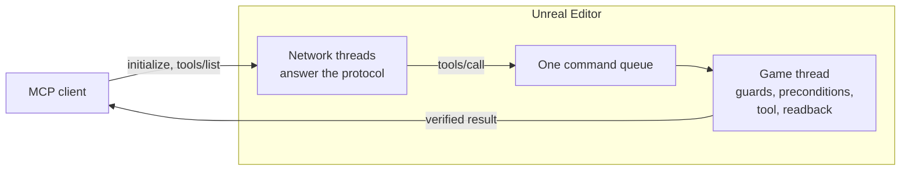

# Architecture

How a call travels from an MCP client to the editor and back, and the contract around it. For the
code layout and how to add a tool, see [CONTRIBUTING.md](https://github.com/CarlxsMG/UEAgent/blob/main/CONTRIBUTING.md).

## The server

`Mcp/McpHttpServer` serves Streamable HTTP from the editor itself, on `127.0.0.1` (port 55561 by
default). An acceptor thread hands each connection to a thread of its own, up to 64:

- `initialize`, `ping` and `tools/list` are answered on that thread, so the editor answers them even
  while it is busy. The `tools/list` answer is serialized once, when the catalog loads.
- `tools/call` crosses to the game thread through the single queue of `UUEAgentBridge`
  (`EnqueueToolCall`): every call, from every client, runs there one at a time, in arrival order.
- While a call runs, its connection thread watches it. If the client asked for progress, the reply
  switches to SSE after 10 seconds and sends a progress notification at least every 15; if the
  client hangs up, the call still finishes and its result is dropped.

`initialize` gives every agent short instructions: how to read a readback verdict and a refusal,
and when to reach for `batch` or `execute_python`.

Every request is checked before anything else: its `Host` must be the loopback and its `Origin`, if
any, local (against DNS rebinding), and with an auth token set, its `Authorization: Bearer` must
match. Headers are capped at 64 KB and a body at 256 MB.

## A call, step by step

On the game thread, `UUEAgentBridge::DispatchSingleCommand` runs every call, and every sub-command of
`batch`, through the same steps:

1. **PIE guards.** While Play-in-Editor runs, calls that compile a Blueprint or write to disk are
   refused unless they carry `force: true`: a compile can keep the play world alive, which the engine
   treats as fatal, and the engine refuses to save during PIE. Starting or stopping a PIE that someone
   else started (by hand, for instance) needs `force: true` too.
2. **Unattended mode.** Modal dialogs are suppressed and answered, so no call can block the game
   thread waiting for a click.
3. **Parameter aliases and rotations.** A parameter spelled the way a sibling tool spells it is
   renamed, and the response says so in `aliased_params`. A `{roll, pitch, yaw}` object becomes the
   wire array `[pitch, yaw, roll]`.
4. **Preconditions** (`Mcp/McpPreconditions`). A call known to crash or freeze the editor is refused,
   with what to do instead. A check reads the arguments, probes the editor state in the same pass, or
   scans the Python that `execute_python` is about to run (`Mcp/McpPythonScan`). When a check exists to
   prevent a crash and cannot verify, it refuses; any other check lets the call through. A content path
   with `//` in any argument, at any depth and in every `batch` item, is refused (`CreatePackage` is
   Fatal on one), except the `value` that `set_usd_attribute_value` and `set_usd_prim_metadata` write:
   that is USD data, where a path expression such as `/World//Mesh` is legitimate. A number
   outside the integer range its parameter is read into (`intRange` in the catalog) is refused too:
   the engine cannot read it, and the tool would otherwise go on with its default. So is a string of
   960 characters or more, or an array element that long, in a parameter that carries a name or a
   content path (`nameLike` in the catalog: its name ends in a word such as name, path, class or
   tag, or its description calls it an FName): an FName holds at most 1023 characters, the engine
   aborts the editor when it builds a longer one, and a tool may add up to 64 characters around a
   name before it builds one (a class prefix, `/Game/Blueprints/`, a `_Font` suffix; the longest the
   commands add is 36). Inside an object of an argument (a rename row, a node spec), a string that
   long under a key the same word rule passes is refused too, at any depth, the key split at `_` and
   at camelCase humps (`newName` reads as new name); the catalog publishes the rule as
   `nameLikeRule`. An asset path and a name are also refused together: an object a tool creates
   inside an asset (a component template `<asset>_C:<name>_GEN_VARIABLE`, a widget
   `<asset>:WidgetTree.<name>`, the graphs under a named state machine) is named after both, and
   recording its creation makes an FName of its whole path, so the longest name-like argument that
   starts with `/` (an object path counted up to its asset) plus the longest other name argument
   must stay under 864 characters, 160 under the limit as for the asset's own objects. Disk paths,
   USD paths and free text are not names; a `batch` item
   whose `command_type` is 1024 characters or more refuses the whole batch, and each item's own
   arguments are checked when it is dispatched. And so is a vector of another shape in a parameter
   every read of which is one of the vector readers (`vectorShape` in the catalog: `vector` for
   `[X, Y, Z]`, `vector2d` for `[X, Y]`, `rotator` for `[pitch, yaw, roll]` or a `{roll, pitch, yaw}`
   object): a value that is not an array (or, for a rotation, an object), an array of another length,
   or an element or axis that is not a finite number. The reader would turn it into the origin, a
   zero scale or a zero rotation, with no error. A parameter also read another way is not marked, and
   an omitted vector keeps its default. A null argument of `tools/call` is dropped before the dispatch
   and so counts as omitted; a null that still arrives (in a `batch` item's params) is refused, since
   a handler that tests the param with `HasField` takes it as present and reads it as zero.
5. **The tool.** Each command family registers its tools in a route table
   (`Mcp/McpCommandFamilies`), and the registry runs the one named, inside one undo transaction
   named after it ("UEAgent: spawn_actor"): Ctrl+Z reverts the whole call, and a `batch` as one
   step. The tools that drive the undo buffer themselves (`undo`, `begin_transaction`...) run
   outside it, and a call that changes nothing leaves no entry.
6. **Readback** (`Mcp/McpReadback`). The state is re-read in the same pass, so a write that did not
   stick, a zero that proves nothing or a change that landed in the wrong world is reported as such
   instead of a plain `success: true`.

A refusal reaches the client as a tool error (`isError: true`); a call that ran and failed answers
with its own `success: false`. Either way the call goes into the session's activity record
(`Mcp/McpActivity`), which the Activity panel shows.

Content under a **Read Only Content Root** is protected where it is written: the shared save helper
refuses to save a package there, and the tools that rename, move or delete check the roots too.

## The catalog

The tools are C++ functions, and what a client sees is generated from them:

- each tool's description and parameters are the `// MCP:` and `@param` annotations above its
  function;
- `Tools/codegen_command_catalog.py` reads the annotations and the route tables and writes
  `Resources/command_catalog.json`, with each tool's MCP `annotations` (read-only, destructive,
  idempotent, open world), which `Tools/tool_hints.py` derives from the code the tool runs and its
  verb: a reader whose code saves, compiles or writes a file is not read-only;
- at startup, `Mcp/McpToolCatalog` builds the `tools/list` schemas from that file (closed enums, the
  `force` parameter of the tools PIE refuses, the aliases, the rotation object form), appends each
  tool's `@returns` shape to its description, and builds the compact list of `Mcp/McpMetaTools`;
- other generators derive the tables the C++ includes from the handlers: the parameters each tool
  reads (so an unknown one is reported in `unknown_params`), the aliases and the tools PIE refuses.
  The `set_`/`get_<x>_properties` pairs are generated from the descriptors in
  `Tools/property_descriptors`, and the [tool reference](tools/README.md) from the catalog.

The CI runs every generator with `--check`, so none of them can drift from the code.

## The contract tests

`Resources/ContractTests` holds recorded vectors for the refusals, the readback and the registry.
`mcp.contract.selftest <vectors.json>` replays them against the C++ with fake probes: it touches no
asset and no world, so it runs in any project, headless included.
