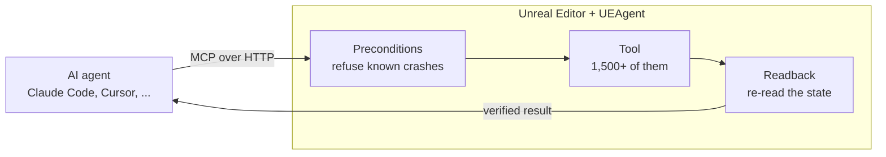

<div class="ua-hero" markdown>


# UEAgent

<p class="ua-hero__lead">The MCP server for Unreal Engine 5, built into the editor.</p>

More than 1,500 tools let Claude Code, Cursor or any MCP client build in Unreal: Blueprints, materials,
levels, animation, Niagara and more. Every call is checked before it runs and read back after.

[Download the latest release](https://github.com/CarlxsMG/UEAgent/releases/latest){ .md-button .md-button--primary }
[Get started](getting-started.md){ .md-button }
[:fontawesome-brands-github: Star on GitHub](https://github.com/CarlxsMG/UEAgent){ .md-button }

</div>

<div class="grid cards" markdown>

-   :material-cube-outline:{ .lg .middle } **The whole engine**

    ---

    Blueprints and their graphs, materials, animation, Niagara, landscapes, World Partition, PCG,
    Sequencer, UMG, GAS, AI, audio, USD and Interchange.

    [:octicons-arrow-right-24: Tool explorer](explorer.md)

-   :material-check-decagram-outline:{ .lg .middle } **Verified, not assumed**

    ---

    Readback re-reads the state after each call. A write that did not stick, or a zero that proves
    nothing, comes back as a failure instead of `success: true`.

    [:octicons-arrow-right-24: Answers and refusals](responses.md)

-   :material-shield-alert-outline:{ .lg .middle } **Refuses what crashes**

    ---

    Calls known to crash or freeze the editor are refused before they run, and the refusal says what
    works instead.

    [:octicons-arrow-right-24: How a call travels](architecture.md)

-   :material-undo-variant:{ .lg .middle } **Safe with your content**

    ---

    Every call is one undo step. Vendored packs listed as **Read Only Content Roots** cannot be saved,
    renamed, moved or deleted by any tool.

    [:octicons-arrow-right-24: Settings](settings.md)

-   :material-lock-outline:{ .lg .middle } **Local and private**

    ---

    The server listens on 127.0.0.1 only and refuses web pages. No telemetry, no analytics, no update
    checks.

    [:octicons-arrow-right-24: Security and privacy](security.md)

-   :material-connection:{ .lg .middle } **Any MCP client**

    ---

    Claude Code connects from the editor's status bar. Cursor, VS Code, Windsurf, Claude Desktop,
    Gemini CLI and Codex connect over Streamable HTTP.

    [:octicons-arrow-right-24: Clients](clients.md)

</div>

## How it works

The plugin is the server: it serves MCP from inside the editor, with no Python or Node process in
between. Every call, from every client, runs on the editor's game thread through one queue.



Two answers an agent gets, as the contract tests in `Resources/ContractTests` record them:

=== "A call that would crash the editor"

    `create_material_expression` with a `SetMaterialAttributes` node trips an assertion in the engine.
    The call never reaches the editor; the agent gets a tool error that names what works instead
    (message shortened here):

    ```json
    {
      "success": false,
      "error": "REFUSED: create_material_expression: creating a `SetMaterialAttributes` node CRASHES THE EDITOR (assertion in Array.h, not an ensure) ... WHAT WORKS: use the Displacement pin of MakeMaterialAttributes.",
      "result": {
        "refused": true,
        "refused_by": "precondition",
        "command": "create_material_expression",
        "check": "set_material_attributes",
        "hint": "Nothing was executed: the call never reached the editor. The message names the way that DOES work."
      }
    }
    ```

=== "A write that did not stick"

    `set_blueprint_variable_default` answered `success: true`, but the stored default is still empty.
    Readback compares what was asked with what was stored, and the agent reads a failure with the way
    that does write:

    ```json
    {
      "success": false,
      "data": {
        "blueprint_name": "BP_X",
        "variable_name": "ConfigRow",
        "default_value": null,
        "roundtrip_verified": true
      },
      "readback": {
        "checked": true,
        "verdict": "wrote_nothing",
        "requested": "/Game/X.X_C",
        "stored": null,
        "how": "in_response:default_value",
        "note": "roundtrip_verified is not the oracle: a None re-exports just as cleanly, so it confirms the failure instead of catching it. A path that does write: set the value on the CDO from Python (get_default_object + set_editor_property), without recompiling afterwards."
      },
      "error": "set_blueprint_variable_default: the call reported success but the state did not change (requested '/Game/X.X_C', stored None)."
    }
    ```

[How to read every answer :octicons-arrow-right-24:](responses.md)

## Up and running

<div class="grid cards ua-steps" markdown>

-   **1. Install**

    ---

    Unzip the [latest release](https://github.com/CarlxsMG/UEAgent/releases/latest), the zip for Unreal
    Engine 5.7 or 5.8, into `<YourProject>/Plugins/`. It is precompiled: no compiler needed, even in a
    Blueprint-only project.

-   **2. Open the project**

    ---

    The editor's status bar shows **MCP · 55561** once the server is up.

-   **3. Connect a client**

    ---

    Claude Code: **MCP · 55561 > Connect Claude Code to this project**; Cursor, VS Code,
    Antigravity CLI and OpenCode: **Connect another client**. Any other client: [Clients](clients.md).

-   **4. Ask**

    ---

    *"Create BP_Door: a door mesh and a box trigger, and open the door with a timeline when the player
    overlaps the trigger."*

</div>

[The full walkthrough :octicons-arrow-right-24:](getting-started.md)

## What you can ask

| Ask | Tools it uses |
|---|---|
| "Find every Blueprint under /Game that does not compile and tell me why." | `find_erroring_blueprints`, `get_graph_nodes`, `lint_blueprint_graph` |
| "Make a red variant of M_Base and put it on the crates in this level." | `create_material_instance`, `set_material_instance_parameter`, `get_actors_by_class`, `set_actor_material` |
| "Play the level, read the player's health, take a screenshot and stop." | `start_play_in_editor`, `get_properties`, `capture_pie_screenshot`, `stop_play_in_editor` |
| "Which assets under /Game/Old have no referencers, and which of them are safe to delete?" | `find_unused_assets`, `get_asset_referencers` |

[More examples :octicons-arrow-right-24:](examples.md)

## Learn more

<div class="grid cards" markdown>

-   [:material-tools: **Tool explorer**](explorer.md): search the 1,500+ tools by name, domain and what
    they do to the project.
-   [:material-robot-outline: **Skills**](skills.md): skills for every client, installed from the
    editor: a skill builder, three skills made with it, and two to report an issue or send a fix.
-   [:material-book-alphabet: **Glossary**](glossary.md): readback, refusals, undo steps and the other
    words the docs use.
-   [:material-help-circle-outline: **FAQ**](faq.md): versions, platforms, safety and cost.
-   [:material-scale-balance: **Choosing a server**](choosing.md): a server inside the editor or outside
    it, and the questions to ask any MCP server for Unreal.
-   [:material-wrench-outline: **Troubleshooting**](troubleshooting.md): when a client cannot connect or
    a call is refused.
-   [:material-sitemap-outline: **Architecture**](architecture.md): how a call travels through the
    editor, and the contract around it.

</div>

UEAgent is open source under the [MIT License](https://github.com/CarlxsMG/UEAgent/blob/main/LICENSE).
Questions go to [Discussions](https://github.com/CarlxsMG/UEAgent/discussions).

## Directories

<!-- include: README.md#directories -->
See the [README](../README.md#directories).
<!-- /include -->
